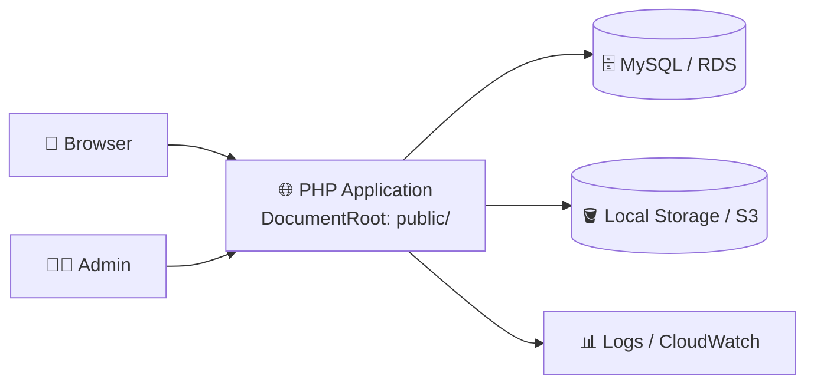
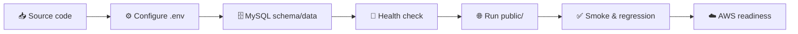

<div align="center">

# 🛒 AWS ECOMMERCE PLATFORM


<br/>


<br/><br/>

Website thương mại điện tử PHP được xây dựng theo hướng triển khai cloud trên AWS.

</div>

## 📖 Giới thiệu project

`aws-ecommerce-platform` là hệ thống bán hàng trực tuyến gồm giao diện khách
hàng, trang quản trị, database MySQL và storage cho product image/runtime upload.

Project tập trung vào:

- 🛍️ Luồng mua hàng: sản phẩm → chi tiết → giỏ hàng → checkout.
- 🧑‍💼 Admin: quản lý sản phẩm, danh mục, thương hiệu, banner và đơn hàng.
- 🖼️ Product image được validate và lưu qua storage abstraction.
- 🔐 Cấu hình portable, security hardening và HTTP/AJAX protection.
- ☁️ Chuẩn bị kiến trúc AWS gồm EC2, RDS, S3, IAM và SSM.

## 🎯 Mục tiêu

<table>
  <tr>
    <td align="center" width="25%"><h3>🏗️ Build</h3>Xây dựng website PHP có frontend và admin workflow.</td>
    <td align="center" width="25%"><h3>🔒 Secure</h3>Bảo vệ session, CSRF, upload và database access.</td>
    <td align="center" width="25%"><h3>🧪 Test</h3>Kiểm tra asset, route, storage và regression.</td>
    <td align="center" width="25%"><h3>☁️ Deploy</h3>Đưa ứng dụng lên hạ tầng AWS có kiểm soát.</td>
  </tr>
</table>

## ✨ Tính năng chính

| Khu vực | Chức năng |
|---|---|
| 👤 Customer | Đăng ký, đăng nhập, tài khoản, xem sản phẩm, tìm kiếm, lọc, giỏ hàng, checkout |
| 🧑‍💼 Admin | CRUD sản phẩm, danh mục, brand, banner và quản lý đơn hàng |
| 🖼️ Images | Validate MIME/kích thước, storage key, local runtime storage và image gateway |
| 🔐 Security | Session protection, CSRF, input validation, upload validation và access guard |
| 🧪 Quality | PHP lint, catalog health check, HTTP smoke test và regression test |

## 🧱 Kiến trúc hệ thống



Mục tiêu production là EC2 public subnet chạy PHP, RDS MySQL private subnet và
S3 private bucket cho runtime upload.

## 🗂️ Cấu trúc thư mục

```text
app/        Storage adapter và service nội bộ
config/     App, database, logging và storage configuration
database/   Schema, migration, health check và import script
deploy/     AWS preflight/readiness script
docs/       Project rules, plans và testing evidence
includes/   Bootstrap, helper, security và database access
public/     DocumentRoot, entrypoint PHP, admin và AJAX
storage/    Runtime logs và uploaded objects
tests/      Integration/manual tests
uploads/    Legacy upload data
images/     Source image gốc
```

## 🛠️ Công nghệ & công cụ

| Nhóm | Công nghệ |
|---|---|
| Backend | PHP 8.x, PDO |
| Database | MySQL/MariaDB |
| Frontend | HTML, CSS, JavaScript |
| Runtime | Apache hoặc PHP built-in server |
| AWS target | EC2, RDS MySQL, S3, IAM, SSM, CloudWatch |
| Development | Git, GitHub, VS Code |

## 🔄 Quy trình chạy project



## ⚙️ Chạy local

Yêu cầu PHP có `pdo_mysql`, `fileinfo`, `curl`, `mbstring` và MySQL đang chạy.

```bash
cp .env.example .env
set -a
source .env
set +a

php -S 127.0.0.1:8000 -t public
```

Mở: `http://127.0.0.1:8000`

## 🧪 Kiểm thử & kiểm tra

```bash
php database/check_catalog_assets.php
bash deploy/aws/application_readiness.sh
find public app config includes database tests -name '*.php' -print0 | xargs -0 -n1 php -l
```

Catalog hiện có 17 sản phẩm, 6 danh mục và 10 thương hiệu. Health check yêu cầu
toàn bộ product image phải `valid`, không có `missing` hoặc `invalid`.

## 🖼️ Product image

Ảnh gốc được giữ trong `images/`. Ảnh runtime được import vào:

```text
storage/uploads/products/YYYY/MM/
```

Database lưu storage key, không lưu đường dẫn tuyệt đối. Một số mapping demo đã
được xác nhận: OPPO dùng ảnh Vivo; Dell và ThinkPad dùng chung ảnh laptop.

## ☁️ Trạng thái AWS

| Hạng mục | Trạng thái |
|---|---|
| EC2 | Đã tạo tại `ap-southeast-1`, instance `t3.micro` |
| EC2 Security Group | HTTP/HTTPS public, không mở MySQL public |
| SSM role | Đã gắn cho EC2 |
| Local readiness | PASS |
| RDS MySQL | Chưa tạo |
| S3 private bucket | Chưa hoàn tất xác nhận |

## 🔐 Nguyên tắc bảo mật

- Không commit `.env`, AWS credentials hoặc database password.
- RDS phải private và không mở port `3306` tới Internet.
- S3 bật Block Public Access và encryption.
- EC2 ưu tiên quản trị bằng SSM thay vì SSH public.
- Upload phải kiểm tra MIME, kích thước và nội dung thực tế.

## ⚠️ Giới hạn hiện tại

- UI chưa redesign hoàn chỉnh.
- Một số product image là mapping tạm thời cho demo.
- RDS và S3 production chưa provision xong.
- Chưa tích hợp payment gateway thật.

## 📌 Trạng thái project

Catalog repair, image import, image health check, regression và local AWS
readiness đã PASS. Bước tiếp theo là hoàn thiện RDS/S3 private và deploy ứng
dụng lên AWS.

<div align="center">

⭐ Build carefully — Test honestly — Deploy securely ⭐


© 2026 AWS Ecommerce Platform

</div>
